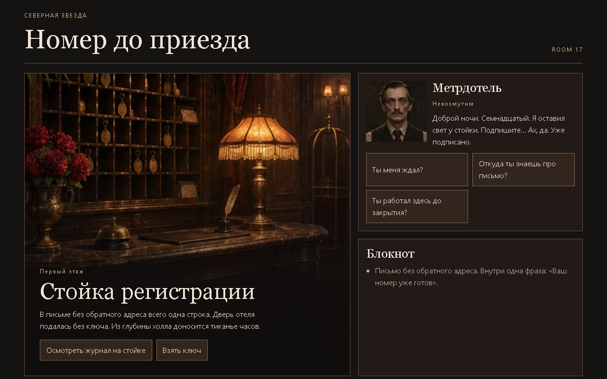

# Room 17 Before Arrival · Номер до приезда

Мистический браузерный детектив. Ты приезжаешь в закрытый отель «Северная звезда» по письму с одной строкой: «Ваш номер уже готов».

Публичная игра: [room17.котификация.рф](https://room17.котификация.рф/).

## Локальный запуск

Открой `index.html` в браузере для прохождения с авторскими диалогами. Установка зависимостей не требуется.

Для необязательного локального разговора с Luna нужен Node.js версии 22 или новее и собственный ключ OpenAI с доступом к модели. В PowerShell запусти `.\start-game.ps1`, введи ключ в скрытом приглашении и открой `http://127.0.0.1:4318`. Запросы к модели могут тарифицироваться. Ключ используется серверным процессом и не передаётся браузеру.

Исходники содержат сюжетные спойлеры. Лицензия — MIT.

## Публичный эфир Luna

В режиме сервера за HTTPS-прокси эфир начинается закрытым. Оператор задаёт срок и лимит до 30 запросов. Авторские диалоги доступны независимо от состояния эфира. После перезапуска эфир закрывается.

Публичный вход обслуживает игру и её API. Управляющий API слушает отдельный loopback-порт и требует серверный токен. Для экземпляра на Праге команда `room17-air status` показывает состояние, `room17-air on` включает эфир на 30 минут по умолчанию с лимитом 30 запросов. Для другого срока передай число секунд, например `room17-air on 60`. Команда `room17-air off` закрывает его.
